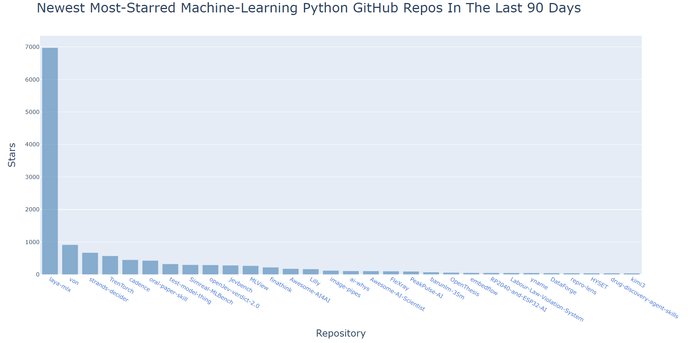
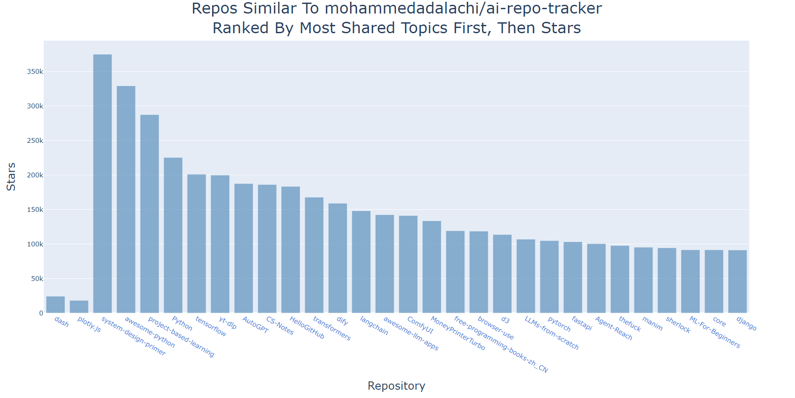

# AI Repo Tracker


Built with:


A command-line program that finds the newest GitHub repositories for a topic,
a programming language, or both, and draws an interactive bar chart of them. It looks at repos created in the
last 90 days and shows the ones with the most stars first. Stars can be
inflated, so this is a list of popular new repos, not a measure of quality.

It can also find similar repos. Give it a repo name like `plotly/dash` and it
reads that repo's topics, searches GitHub for repos with the same topics, and
ranks them by how many topics they share. See "Find similar repos" below.



## What it does

1. Asks for a repo name like `owner/name`. Press Enter to skip it. If you type
   one, the program finds repos that share its topics (see "Find similar repos"
   below).
2. Asks for a topic, for example `machine learning` or `llm`. Press Enter to skip it.
3. Asks for a programming language, for example `python` or `c++`. Press Enter
   to skip it. You must give at least one of the two.
4. Calls the GitHub API and gets the first page of matching repos.
5. Prints each repo name and its star count.
6. Saves the chart as `topic_language.html` and opens it in the browser.
7. Saves the results to `topic_language.json`. If that file is less than an hour
   old, the program reads it instead of calling GitHub again.

A topic is a tag the owner put on the repo. A language is the language the repo
is written in. The topic `cpp` is the tag for C++ projects, while the language
`c++` means code written in C++.

In the chart, each bar is one repo. Click a repo name to open it on GitHub.
Hover over a bar to see the owner and the description.

## Find similar repos

Type a repo name such as `plotly/dash` at the first question. The program reads
that repo's topics from GitHub and searches for other repos with the same
topics. It searches once per topic and counts in how many searches each repo
appears. The chart shows the top 30, with the most shared topics first and then
the most stars. Because of this order, the bars are not sorted by stars. This
search is not cached.

This is a rough guide, not a measure of real similarity. Each topic search reads
only the first 30 results by stars, so broad topics such as `python` bring in
popular repos that are not truly similar. The repos that share the most topics
are the best matches.



In this chart, `dash` and `plotly.js` come first because they share the most
topics with the tracker, even though their star counts are lower than the repos
after them.

## Tech stack

| Tool | Used for |
| --- | --- |
| Python | The whole program |
| `requests` | Calling the GitHub search API |
| `plotly` | The interactive bar chart (saved as HTML) |
| `json` | Caching results per search |
| `pytest` | Tests with a fixture, monkeypatch and a fake `requests` |
| Git and GitHub | Version control and hosting |

## Requirements

- Python 3.10 or newer
- `requests`, `plotly` and `pytest` (listed in `requirements.txt`)

Install them with:

```text
python -m pip install -r requirements.txt
```

## How to run

```text
python tracker.py
```

Press Enter at the first question to skip it, or type a repo name like
`owner/name` to find similar repos. Then type a topic and press Enter, and type
a language and press Enter. Skip one of them by pressing Enter. Type `q` at the
first or the topic question to quit.

## If something goes wrong

The program catches these problems, prints a message and asks for the next
search. It does not crash.

| Message | What it means |
| --- | --- |
| `Sorry! No Internet.` | The program could not reach GitHub. Check your connection. |
| `GitHub took too long.` | GitHub did not answer within 10 seconds. Try again. |
| `GitHub rate limit was reached. Please! Wait a minute.` | Status 403. You made too many requests. Wait a minute. |
| `GitHub answered with status: ...` | Any other status that is not 200. Status 404 after a repo name means the repo does not exist. |
| `GitHub's response wasn't in the expected shape` | The answer did not have the data the program needs. |
| `Sorry! The json file got corrupted.` | The saved cache file was damaged. The program deletes it, so search again. |

## Run the tests

```text
python -m pytest
```

## Files

| File | What it holds |
| --- | --- |
| `tracker.py` | The program: fetching, finding similar repos, saving, loading and the chart |
| `repo.py` | The `Repo` class (name, stars, owner, url, description) |
| `test_tracker.py` | Eight pytest tests with a fixture, monkeypatch and a fake `requests` |
| `requirements.txt` | The libraries the project needs |
| `HOW_TO_RUN_WINDOWS.md` | A setup guide for beginners on Windows |
| `HOW_TO_RUN_LINUX.md` | A setup guide for beginners on Linux |
| `HOW_TO_RUN_MACOS.md` | A setup guide for beginners on macOS |
| `LICENSE` | The MIT license |

## License

MIT. See the `LICENSE` file.

## What I practiced

Classes, functions, loops, error handling, JSON files, the GitHub API,
Plotly charts, pytest, and git. For the similar-repos feature: counting with
dictionaries, sorting by two rules (shared topics, then stars), and testing
with a fake `requests`.
